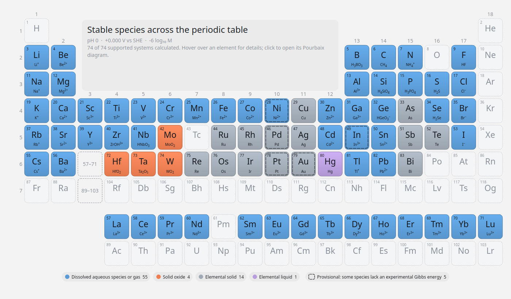

<p align="center">
  <picture>
    <source media="(prefers-color-scheme: dark)" srcset="docs/logo-wordmark-dark.svg">
    
  </picture>
</p>

pourbase is a source-linked database of experimental standard thermochemistry and a Python package
for calculating Pourbaix diagrams at 298.15 K and 1 bar. The bundled SQLite database holds 544
aqueous, solid, liquid and gas species across 74 elemental systems. Every value keeps its citation,
exact source location, evidence status, uncertainty when available, phase identity and scientific
warnings. Reviewed crystalline phases are matched to Materials Project structures and DFT formation
energies.

> [!NOTE]
> **A living, source-linked database.** Candidate sources were found with an agentic literature
> search (GPT 5.6 Sol). Each value is stored with its citation, its exact location in the source and
> an evidence status, so you can check it before you rely on it. Found an error or a better source?
> [Help improve the data](CONTRIBUTING.md).

<p align="center">
  <a href="STATISTICS.md">Dataset statistics</a> ·
  <a href="CONTRIBUTING.md">Contributing</a> ·
  <a href="docs/DATA_DICTIONARY.md">Data dictionary</a>
</p>

<p align="center">
  
</p>

## Install

From PyPI:

```bash
pip install pourbase                           # database, calculations and command line
pip install "pourbase[gui]"                    # plus the desktop application
pip install "pourbase[gui,materials-project]"  # plus live Materials Project comparisons
pip install "pourbase[mcp]"                    # plus the MCP server for language-model agents
pourbase-gui
```

From a clone of this repository, in a virtual environment (Python 3.11 or newer):

```bash
git clone https://github.com/FrederikLizakJohansen/pourbase.git
cd pourbase
python -m venv .venv
source .venv/bin/activate            # Windows: .venv\Scripts\activate
pip install ".[gui]"                 # add ",materials-project" for live DFT comparisons
pourbase-gui
```

Use `pip install -e ".[gui]"` instead to work on the code; `python -m unittest discover -s tests`
runs the tests. Without `[gui]`, the package installs the database, the Python API and the
`pourbase` command line only.

The database ships inside the package. Experimental calculations run offline and need no download,
API key or data path.

## Desktop application

Start it with `pourbase-gui`, or `pourbase gui Fe` to open one element directly.

The application opens on a periodic table showing the stable species of every supported element at
a chosen pH and potential (SHE or RHE). Hover over an element for its stable species and Gibbs
source; click it to open the system. For one system you get:

- fixed-activity and closed total-metal (mass-balance) diagrams that update as you change settings;
- concentration as log10 molarity, molarity, ppm or weight percent; ideal or Davies activity
  coefficients; gas fugacity; ligand reservoirs for the ligands that complex the element;
- a probe with the stable species, its Gibbs energy, uncertainty and source, the runner-up species
  with its energy margin, the next species above and below in potential and pH, and in mass-balance
  mode the dissolved and precipitated metal;
- hatching of the regions where another species lies within 1, 2 or 3 combined uncertainties of the
  stable one, using reported ΔfG° uncertainties and an adjustable assumed value where none is
  reported;
- the potential axis against the SHE, RHE, Ag/AgCl, SCE or Hg/HgO;
- a side-by-side comparison with a second element or concentration on linked axes;
- tables of every species with recommended and reported values and citations, and of the balanced
  boundary reactions and Nernst equations;
- species fractions along pH;
- a concentration sweep over log10 activity, pH and Eh, drawn as a rotatable 3D stack that can be
  sliced along any axis;
- a DFT comparison with the official Materials Project diagram: both diagrams and an agreement map
  side by side, also available in the sweep and speciation views;
- sessions saved to and opened from `.pourbase.json` files (`pourbase-gui session.pourbase.json`
  opens one directly); every exported figure gets one next to it;
- export of figures (PNG, PDF, SVG), calculated grids (CSV) and the equivalent Python code.

The DFT comparison needs the `materials-project` extra and a free API key from the
[Materials Project](https://materialsproject.org/api). Enter it under Tools → Materials Project API
key; the application can remember it in the system keyring.

## Python

A `Scenario` describes one diagram in everyday units; `calculate` returns the diagram with its
evidence:

```python
import pourbase as pb

calculation = pb.calculate(pb.Scenario("Fe", concentration=10, concentration_unit="ppm", allow_incomplete=True))
pb.plot_diagram(calculation.diagram)

for boundary in calculation.boundaries:
    print(boundary.reaction, boundary.equation, boundary.source_ids)

probe = calculation.probe(pH=7, eh_V=0)
record = pb.open_database().species_records([probe.species.record_id])[0]
print(probe.species.species, record.thermochemistry.gibbs_energy_J_mol.source.citation)
```

Conserve a closed total-metal inventory, with Davies activity coefficients, and follow the species
fractions along pH:

```python
calculation = pb.calculate(pb.Scenario(
    "Zn", mode="mass_balance", concentration=1e-6, concentration_unit="molar",
    davies_ionic_strength_mol_L=0.01,
))
pb.plot_speciation_profile(pb.speciation_profile(calculation.diagram, eh_V=0.0))
```

Add buffered ligands, here chloride at a free activity of 10⁻²:

```python
chloride = pb.LigandActivity("chloride-cl", log10_free_activity=-2)
pb.plot_diagram(pb.calculate(pb.Scenario("Ag", ligands=(chloride,))).diagram)
```

Six solids lack a recommended experimental Gibbs energy. Additional records retain verified
entropy data while their formation energies await source review. Strict calculations report
these gaps with `IncompleteSystemError`. Use `allow_incomplete=True` to calculate with the
available Gibbs energies and inspect the excluded species. Systems with entropy-only
records include Fe, Ni and several other metals; `load_system(symbol).missing_gibbs`
lists the exact gaps. The desktop system view enables incomplete calculations by default.
Separately stored Materials Project estimates cover the six solid gaps:

```python
exploratory = pb.calculate(pb.Scenario("Pt", allow_incomplete=True))
estimated = pb.calculate(pb.Scenario("Pt", energy_policy="experimental_then_mp"))
```

How firmly a species is stable, given the Gibbs energy uncertainties (fixed activity):

```python
calculation = pb.calculate(pb.Scenario("Fe", allow_incomplete=True))
margin = pb.stability_margin(calculation.diagram, pH=7, eh_V=0.0)
print(margin.runner_up.species, margin.margin_J_mol_metal, margin.margin_uncertainty_J_mol_metal)
print(margin.higher_potential.species.species, margin.higher_potential.distance)
uncertain = pb.stability_uncertainty(calculation.diagram, confidence_sigma=1.0)
print(f"{uncertain.uncertain_fraction:.0%} of the grid is within 1σ of another species")
```

The stable species of every element at one pH and potential:

```python
screen = pb.screen_periodic_table(pH=7, potential_V=0.4, reference="RHE", allow_incomplete=True)
print(screen.element("Fe").stable.species, screen.calculated_count)
```

Sweep the metal activity; levels are stored compactly and the progress callback can cancel:

```python
conditions = pb.Scenario("Fe").conditions()
sweep = pb.ConcentrationSweepEngine(pb.open_database()).calculate("Fe", conditions, -10, 0, points=41, allow_incomplete=True)
pb.plot_concentration_sweep(sweep, probe_pH=7, probe_eh_V=0)
```

Compare with the official Materials Project diagram (needs the `materials-project` extra):

```python
from pourbase import OfficialMaterialsProjectClient, OfficialMaterialsProjectComparator, PourbaixEngine

client = OfficialMaterialsProjectClient(api_key="your Materials Project API key")
comparison = OfficialMaterialsProjectComparator(PourbaixEngine(pb.open_database()), client).compare(
    "Fe", pb.Scenario("Fe").conditions(), allow_incomplete=True
)
pb.plot_official_materials_project_comparison(comparison)
print(comparison.equivalent_domain_fraction, comparison.materials_project.database_version)
```

Calculate with your own species, or replace a bundled value, from a CSV file (format in
`pourbase.user_data`); user values carry the status `user_supplied` in every result:

```python
database = pb.with_user_species(pb.open_database(), "own-species.csv")
calculation = pb.calculate(pb.Scenario("Cu"), database)
```

Or use your data on its own: `pb.open_dataset("own-species.csv")` builds a database that holds only
those species (a pourbase SQLite file opens the same way), and `pourbase-gui own-species.csv` or File
→ Open dataset shows it in the application.

```python
dataset = pb.open_dataset("own-species.csv")
calculation = pb.calculate(pb.Scenario("Cu"), dataset)
```

With pymatgen set to the same water energy and Nernst slope, every bundled system gives the same
diagram as pymatgen's `PourbaixEntry` evaluation; `scripts/pymatgen_crosscheck.py` writes the
comparison to `docs/validation/`, and the test suite repeats it.

The lower-level `PourbaixEngine`, `MassBalanceEngine` and `PourbaixConditions` take the same
settings as explicit models, for custom calculations.

## Command line

```bash
pourbase systems
pourbase plot Fe --allow-incomplete --output fe.png
pourbase plot Zn --mode mass_balance --total-metal 1e-6 --output zn.png
pourbase plot Fe --allow-incomplete --concentration 10 --unit ppm --grid-csv fe-grid.csv
pourbase plot Pt --use-mp-fallbacks --output pt.png
pourbase sweep Fe --allow-incomplete --minimum -10 --maximum 0 --points 7 --output fe-sweep.png
pourbase mp-thermo-figures --output-dir mp-thermochemistry
```

## Agents (MCP)

`pourbase-mcp` is a [Model Context Protocol](https://modelcontextprotocol.io) server that gives
language-model agents the database and the engine over standard input and output. Register it with
an MCP client, for example Claude Code:

```bash
claude mcp add pourbase -- pourbase-mcp
```

or in a client's JSON configuration:

```json
{"mcpServers": {"pourbase": {"command": "pourbase-mcp", "args": []}}}
```

| Tool | Returns |
|---|---|
| `list_systems` | elemental systems, dataset version, reference state |
| `list_ligands` | ligands that can be buffered and the complexes they form |
| `get_species` | species of one element with recommended Gibbs energy, uncertainty, status and source |
| `get_record` | the full evidence record of one species: every reported value, locators, warnings |
| `search_species` | species matching a name, formula or record ID |
| `calculate_diagram` | stable species with their share of the diagram, boundary equations, excluded species |
| `probe_point` | the stable species at one pH and potential, its margin and the nearest boundaries |
| `render_diagram` | the diagram as a PNG image |
| `compare_policy` | every Gibbs energy a selection policy (TOML text) chooses differently from the default |

Calculations take the mode, concentration and unit, buffered ligands, ionic strength and axis
ranges of the Python API. `--dataset`, `--species` and `--policy` start the server on a user
dataset, with user species, or with another selection policy.

## How values are selected

`reported_thermochemistry` holds every reported value from every source; the database file stores
no recommendations. When the package opens the database, the selection policy chooses one value
per species and property, which the calculations use and which every connection sees as the
temporary table `selected_thermochemistry`. Loading another policy changes the recommendations without
changing the file. Values are not averaged: many
apparent alternatives are copies of the same measurement or use different conventions. Missing
values stay visible as explicit evidence gaps.

The recommendation follows a selection policy, the file `src/pourbase/data/selection-policy.toml`.
It ranks sources by evidence class (A international critical reviews; B critical compilations, NBS
Tables first; C single-system evaluations; D single experimental papers; E estimates, fitted models
before correlations; F computed values), breaks ties within a class, and lists every exception
with its reason. The bundled recommendations are the output of this file, and a test keeps them so.
Copy and edit the file to calculate with your own rule, without changing the database:

```python
policy = pb.SelectionPolicy.load("my-policy.toml")
calculation = pb.calculate(pb.Scenario("Fe"), pb.with_policy(pb.open_database(), policy))
changes = pb.compare_policies(pb.open_database(), pb.SelectionPolicy.default(), policy)
```

`python scripts/selection_report.py my-policy.toml` lists every value your policy changes and the
effect on each element's diagram. In the desktop application, load a policy from the File menu; the
Species tab shows the class of every value and why it was chosen.

Solids are compared with Materials Project on their O and H content per metal, and aqueous species
on their proton and electron coefficients and metal count. Differences between experimental Gibbs
energies and DFT formation energies are diagnostics, not experimental error estimates.

## Sources, evidence and contributing

The literature search behind the database was agentic, using GPT 5.6 Sol to locate candidate
sources and the values in them. Every value keeps its full citation, the exact table, row or page
it came from, an evidence status, every alternative and superseded value, warnings, and explicit
gaps where no defensible value was found; Materials Project estimates are kept separately and used
only on request. Check the cited source for any value your conclusions depend on. The Species tab
of the application and `ThermodynamicDatabase.species_records` show the citation and locator of
every value.

pourbase is a living database. Report a wrong value, a missing species or a better source with the
[Data correction or addition](https://github.com/FrederikLizakJohansen/pourbase/issues/new/choose)
issue form; [CONTRIBUTING.md](CONTRIBUTING.md) describes what to include and how to contribute
code.

## Concentration conventions

- `log10_molar`: base-10 logarithm of the concentration relative to 1 mol L⁻¹.
- `molar`: mol of elemental metal per litre.
- `ppm`: mg of elemental metal per litre of solution.
- `wt_percent`: mass percentage of elemental metal in the solution; the solution density (default
  1 kg L⁻¹) converts mass to volume.

In fixed-activity mode the concentration sets the activity of every aqueous metal species. In
mass-balance mode it sets the conserved total metal concentration. Atomic weights follow
[CIAAW](https://ciaaw.org/atomic-weights.htm).

## Scientific limits

- 298.15 K and 1 bar, in water.
- One independently conserved metal per calculation.
- Fixed-activity mode treats aqueous activities as externally buffered.
- The Davies model applies up to an ionic strength of 0.1 mol L⁻¹, as a fixed background.
- Ligands are buffered reservoirs; there is no closed ligand balance.
- `allow_incomplete=True` omits species without a recommended Gibbs energy and gives an
  exploratory diagram.
- Materials Project comparisons use one activity for all aqueous species and ligand-free systems.

## Repository

| Path | Contents |
|---|---|
| `src/pourbase/` | Python package, with the database in `data/` and the application in `gui/` |
| `docs/` | Data dictionary and exploratory temperature-trend model |
| `scripts/`, `data/statistics/` | The script that writes [STATISTICS.md](STATISTICS.md), and its inputs |
| `tests/` | Database, calculation and application tests |

Run the tests with `python -m unittest discover -s tests`. Regenerate the statistics with
`python scripts/dataset_statistics.py`.

## Citation and licence

pourbase is released under GPL-3.0. Cite this release (`CITATION.cff`) and the sources attached to
the values you use. `THIRD_PARTY_NOTICES.md` lists the terms of the data sources, and
`docs/DATA_DICTIONARY.md` describes every table.
