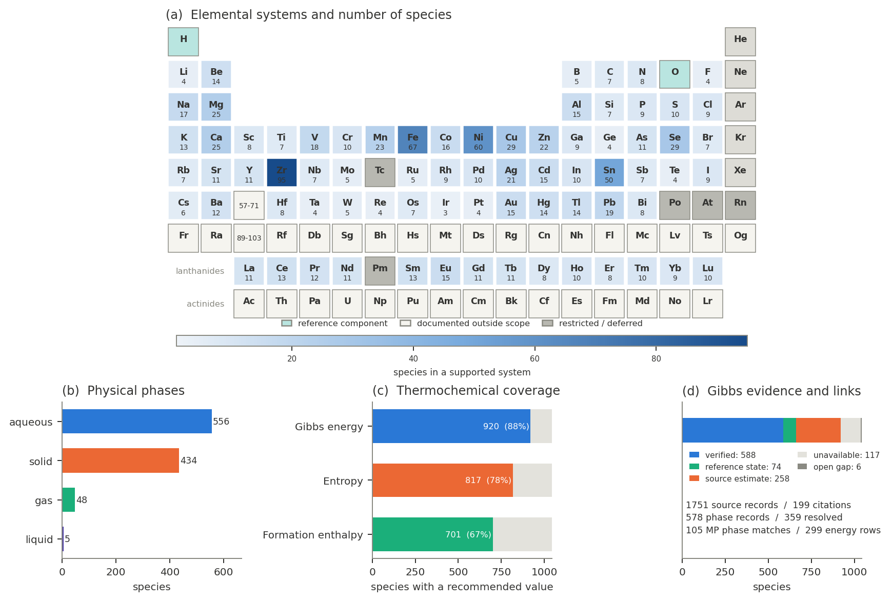
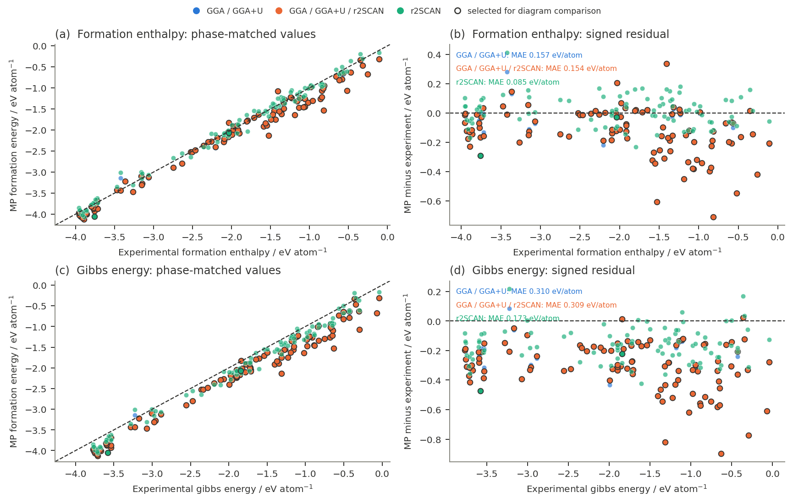
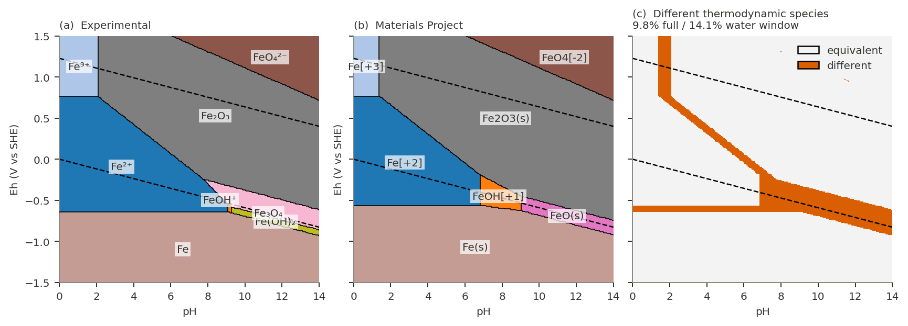

# Dataset statistics

pourbase dataset 1.0.0, generated from the bundled database by `scripts/dataset_statistics.py`. Machine-readable versions are in [`docs/statistics`](docs/statistics).

## Summary

| | |
|---|---|
| Species | 1043 |
| Supported elemental systems | 74 of 118 elements |
| Recommended Gibbs energies | 920 (88 %) |
| Recommended entropies | 817 (78 %) |
| Recommended formation enthalpies | 701 (67 %) |
| Reported values retained | 3313 |
| Source records | 1751 (199 distinct citations) |
| Phase records | 578 (359 resolved) |
| Warnings | 1418 |
| Materials Project matches | 105 phases, 299 energy rows |
| Materials Project fallback estimates | 6 |
| Ligands | 29 |

Gibbs energies by evidence status:

| Status | Species |
|---|---|
| `verified` | 588 |
| `source_verified_estimate` | 258 |
| `not_available` | 117 |
| `defined_reference_state` | 74 |
| `terminal_evidence_gap` | 6 |

Species by phase:

| Phase | Species | Gibbs | Entropy | Enthalpy |
|---|---|---|---|---|
| aqueous | 556 | 491 | 420 | 299 |
| solid | 434 | 381 | 346 | 352 |
| gas | 48 | 45 | 48 | 45 |
| liquid | 5 | 3 | 3 | 5 |

## Database tables

| Table | Rows | Contents |
|---|---|---|
| `species` | 1043 | Formula, charge, phase, composition, oxidation state and reaction coefficients |
| `selected_thermochemistry` | 1043 | Derived by the selection policy: one recommended Gibbs energy, entropy and enthalpy per species |
| `reported_thermochemistry` | 3313 | Every retained reported value, recommended or not, with supersession links |
| `sources` | 1751 | Full citations, links, locators and access dates |
| `phases` | 578 | Phase identity, candidate polymorphs, space group and evidence |
| `warnings` | 1418 | Scientific cautions attached to records |
| `computational_fallbacks` | 6 | Opt-in Materials Project 300 K estimates for missing solid Gibbs energies |
| `materials_project_matches` | 105 | Reviewed experimental-phase to Materials Project structure matches |
| `materials_project_energies` | 299 | Method-specific Materials Project energies with provenance |
| `element_coverage` | 118 | Status of every chemical element |
| `ligands` | 29 | Free-ligand reference states for ligand-aware calculations |
| `additional_components` | 11 | Additional independent buffered references per species, beyond the first ligand |
| `metadata` | 34 | Dataset version, reference conditions, schema version and value policy |

[`docs/DATA_DICTIONARY.md`](docs/DATA_DICTIONARY.md) defines every column, unit and join.

## Coverage

Elemental coverage, species by phase, property availability and evidence status.

## Comparison with Materials Project

Phase-matched experimental formation energies against Materials Project DFT formation energies (database 2026.04.13). Mean absolute differences, in eV per atom:

| Method | Enthalpy (n) | Enthalpy MAE | Gibbs (n) | Gibbs MAE |
|---|---|---|---|---|
| GGA_GGA+U | 99 | 0.155 | 103 | 0.307 |
| GGA_GGA+U_R2SCAN | 99 | 0.151 | 103 | 0.307 |
| r2SCAN | 90 | 0.085 | 93 | 0.171 |

The enthalpy is the closest comparison with a 0 K DFT formation energy; the Gibbs difference also includes finite-temperature entropy. These differences are diagnostics, not experimental error estimates.

## Example: the iron system

The experimental Fe diagram at log₁₀ a = -6 and the official Materials Project diagram (database 2026.04.13) have the same thermodynamic species over 91 % of the grid and 89 % of the water-stability window.

## Systems

| Element | System | Species | Aqueous | Solid | Gas | Liquid | Gibbs | Entropy | Enthalpy | Warnings |
|---|---|---|---|---|---|---|---|---|---|---|
| Ag | Silver (Ag) | 21 | 12 | 9 | 0 | 0 | 20 | 20 | 17 | 37 |
| Al | Aluminum (Al) | 15 | 6 | 9 | 0 | 0 | 14 | 13 | 12 | 29 |
| As | Arsenic (As) | 11 | 7 | 4 | 0 | 0 | 11 | 10 | 10 | 4 |
| Au | Gold (Au) | 15 | 13 | 2 | 0 | 0 | 11 | 8 | 3 | 23 |
| B | Boron (B) | 5 | 3 | 2 | 0 | 0 | 5 | 5 | 5 | 1 |
| Ba | Barium (Ba) | 12 | 6 | 6 | 0 | 0 | 12 | 12 | 10 | 22 |
| Be | Beryllium (Be) | 14 | 11 | 3 | 0 | 0 | 5 | 14 | 3 | 26 |
| Bi | Bismuth (Bi) | 8 | 5 | 3 | 0 | 0 | 6 | 5 | 2 | 13 |
| Br | Bromine (Br) | 7 | 6 | 0 | 0 | 1 | 7 | 7 | 7 | 0 |
| C | Carbon (C) | 7 | 4 | 1 | 2 | 0 | 7 | 7 | 7 | 9 |
| Ca | Calcium (Ca) | 25 | 11 | 14 | 0 | 0 | 25 | 23 | 21 | 54 |
| Cd | Cadmium (Cd) | 15 | 12 | 3 | 0 | 0 | 9 | 11 | 4 | 21 |
| Ce | Cerium (Ce) | 13 | 7 | 6 | 0 | 0 | 12 | 9 | 10 | 14 |
| Cl | Chlorine (Cl) | 9 | 8 | 0 | 1 | 0 | 9 | 9 | 9 | 1 |
| Co | Cobalt (Co) | 16 | 7 | 9 | 0 | 0 | 12 | 15 | 8 | 26 |
| Cr | Chromium (Cr) | 10 | 8 | 2 | 0 | 0 | 7 | 9 | 1 | 12 |
| Cs | Caesium (Cs) | 6 | 5 | 1 | 0 | 0 | 5 | 6 | 3 | 9 |
| Cu | Copper (Cu) | 29 | 16 | 13 | 0 | 0 | 22 | 27 | 16 | 50 |
| Dy | Dysprosium (Dy) | 8 | 5 | 3 | 0 | 0 | 8 | 6 | 6 | 9 |
| Er | Erbium (Er) | 8 | 5 | 3 | 0 | 0 | 8 | 6 | 7 | 10 |
| Eu | Europium (Eu) | 15 | 7 | 8 | 0 | 0 | 14 | 10 | 11 | 17 |
| F | Fluorine (F) | 4 | 3 | 0 | 1 | 0 | 4 | 4 | 4 | 1 |
| Fe | Iron (Fe) | 67 | 29 | 38 | 0 | 0 | 56 | 45 | 41 | 85 |
| Ga | Gallium (Ga) | 9 | 6 | 3 | 0 | 0 | 7 | 8 | 2 | 17 |
| Gd | Gadolinium (Gd) | 11 | 6 | 5 | 0 | 0 | 10 | 6 | 7 | 12 |
| Ge | Germanium (Ge) | 4 | 1 | 3 | 0 | 0 | 4 | 3 | 3 | 2 |
| Hf | Hafnium (Hf) | 8 | 6 | 2 | 0 | 0 | 8 | 8 | 8 | 17 |
| Hg | Mercury (Hg) | 14 | 11 | 1 | 1 | 1 | 9 | 14 | 8 | 21 |
| Ho | Holmium (Ho) | 10 | 6 | 4 | 0 | 0 | 10 | 7 | 8 | 12 |
| I | Iodine (I) | 9 | 8 | 1 | 0 | 0 | 9 | 8 | 8 | 1 |
| In | Indium (In) | 10 | 7 | 3 | 0 | 0 | 6 | 8 | 2 | 17 |
| Ir | Iridium (Ir) | 3 | 1 | 2 | 0 | 0 | 3 | 2 | 2 | 2 |
| K | Potassium (K) | 13 | 10 | 3 | 0 | 0 | 13 | 12 | 10 | 33 |
| La | Lanthanum (La) | 11 | 5 | 6 | 0 | 0 | 10 | 7 | 8 | 13 |
| Li | Lithium (Li) | 4 | 3 | 1 | 0 | 0 | 4 | 4 | 2 | 3 |
| Lu | Lutetium (Lu) | 10 | 6 | 4 | 0 | 0 | 10 | 7 | 7 | 11 |
| Mg | Magnesium (Mg) | 25 | 10 | 15 | 0 | 0 | 22 | 19 | 19 | 54 |
| Mn | Manganese (Mn) | 23 | 11 | 12 | 0 | 0 | 20 | 21 | 16 | 33 |
| Mo | Molybdenum (Mo) | 5 | 1 | 4 | 0 | 0 | 5 | 5 | 3 | 2 |
| N | Nitrogen (N) | 8 | 5 | 0 | 3 | 0 | 8 | 8 | 8 | 20 |
| Na | Sodium (Na) | 17 | 10 | 7 | 0 | 0 | 16 | 15 | 13 | 37 |
| Nb | Niobium (Nb) | 7 | 4 | 3 | 0 | 0 | 7 | 4 | 4 | 5 |
| Nd | Neodymium (Nd) | 11 | 5 | 6 | 0 | 0 | 10 | 7 | 9 | 15 |
| Ni | Nickel (Ni) | 60 | 28 | 30 | 1 | 1 | 55 | 43 | 44 | 65 |
| Os | Osmium (Os) | 7 | 2 | 4 | 1 | 0 | 7 | 5 | 5 | 8 |
| P | Phosphorus (P) | 9 | 7 | 2 | 0 | 0 | 9 | 7 | 7 | 2 |
| Pb | Lead (Pb) | 19 | 10 | 9 | 0 | 0 | 17 | 18 | 14 | 42 |
| Pd | Palladium (Pd) | 10 | 7 | 3 | 0 | 0 | 9 | 3 | 1 | 10 |
| Pr | Praseodymium (Pr) | 12 | 7 | 5 | 0 | 0 | 10 | 5 | 7 | 15 |
| Pt | Platinum (Pt) | 4 | 1 | 3 | 0 | 0 | 2 | 2 | 0 | 9 |
| Rb | Rubidium (Rb) | 7 | 6 | 1 | 0 | 0 | 6 | 7 | 4 | 11 |
| Re | Rhenium (Re) | 4 | 1 | 3 | 0 | 0 | 4 | 4 | 2 | 0 |
| Rh | Rhodium (Rh) | 9 | 6 | 3 | 0 | 0 | 9 | 8 | 8 | 13 |
| Ru | Ruthenium (Ru) | 5 | 2 | 3 | 0 | 0 | 5 | 5 | 2 | 5 |
| S | Sulfur (S) | 10 | 9 | 1 | 0 | 0 | 10 | 9 | 9 | 3 |
| Sb | Antimony (Sb) | 7 | 3 | 4 | 0 | 0 | 7 | 5 | 5 | 3 |
| Sc | Scandium (Sc) | 8 | 5 | 3 | 0 | 0 | 8 | 8 | 8 | 13 |
| Se | Selenium (Se) | 29 | 11 | 7 | 11 | 0 | 26 | 22 | 25 | 40 |
| Si | Silicon (Si) | 7 | 5 | 2 | 0 | 0 | 7 | 5 | 5 | 11 |
| Sm | Samarium (Sm) | 13 | 7 | 6 | 0 | 0 | 12 | 6 | 8 | 16 |
| Sn | Tin (Sn) | 50 | 23 | 18 | 8 | 1 | 48 | 28 | 26 | 46 |
| Sr | Strontium (Sr) | 11 | 6 | 5 | 0 | 0 | 11 | 11 | 9 | 20 |
| Ta | Tantalum (Ta) | 4 | 2 | 2 | 0 | 0 | 4 | 2 | 1 | 6 |
| Tb | Terbium (Tb) | 11 | 6 | 5 | 0 | 0 | 10 | 7 | 8 | 13 |
| Te | Tellurium (Te) | 4 | 2 | 2 | 0 | 0 | 4 | 3 | 3 | 2 |
| Ti | Titanium (Ti) | 7 | 2 | 5 | 0 | 0 | 7 | 7 | 4 | 15 |
| Tl | Thallium (Tl) | 14 | 10 | 4 | 0 | 0 | 9 | 13 | 6 | 20 |
| Tm | Thulium (Tm) | 10 | 6 | 4 | 0 | 0 | 10 | 7 | 7 | 11 |
| V | Vanadium (V) | 18 | 13 | 5 | 0 | 0 | 14 | 16 | 7 | 17 |
| W | Tungsten (W) | 5 | 1 | 4 | 0 | 0 | 5 | 5 | 3 | 6 |
| Y | Yttrium (Y) | 11 | 8 | 3 | 0 | 0 | 11 | 9 | 9 | 24 |
| Yb | Ytterbium (Yb) | 9 | 6 | 3 | 0 | 0 | 9 | 6 | 6 | 10 |
| Zn | Zinc (Zn) | 22 | 10 | 12 | 0 | 0 | 21 | 21 | 18 | 47 |
| Zr | Zirconium (Zr) | 95 | 26 | 49 | 19 | 1 | 74 | 66 | 76 | 115 |
