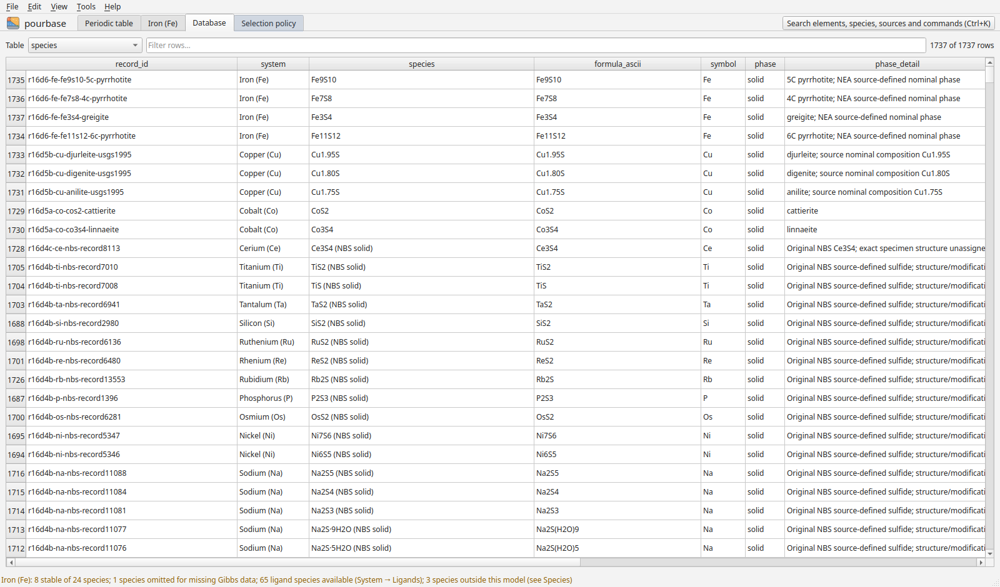

# Database

The Database tab lists every species with its recommended values, and for each value its status, uncertainty,
source and exact location in the source. Alternative published values are shown beside the recommended one.
Tools → Sources behind this diagram lists the sources of the current diagram, with BibTeX.
