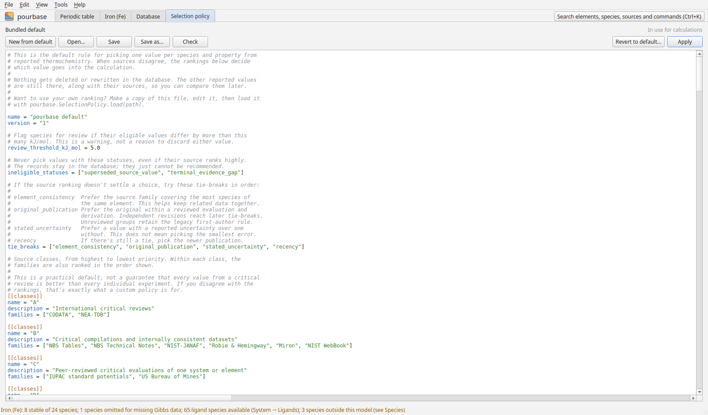

# Selection policy

The Selection policy tab shows the active policy as TOML text, with comments that explain each key. See
[How values are selected](../data/selection.md) for what the keys mean.

| Button | Does |
|---|---|
| New from default | Starts again from the bundled default |
| Open…, Save, Save as… | Load and save policy files |
| Check | Lists problems under the text: invalid TOML, unknown names, overrides that name a record or source the database does not have. Click a problem to jump to its line |
| Apply | Recalculates everything with the text as it stands; the status bar says how many recommended values differ from the default |
| Revert to default… | Returns to the bundled default, after a warning |

Tools → Compare selection policies lists every value that a policy chooses differently from the default.
