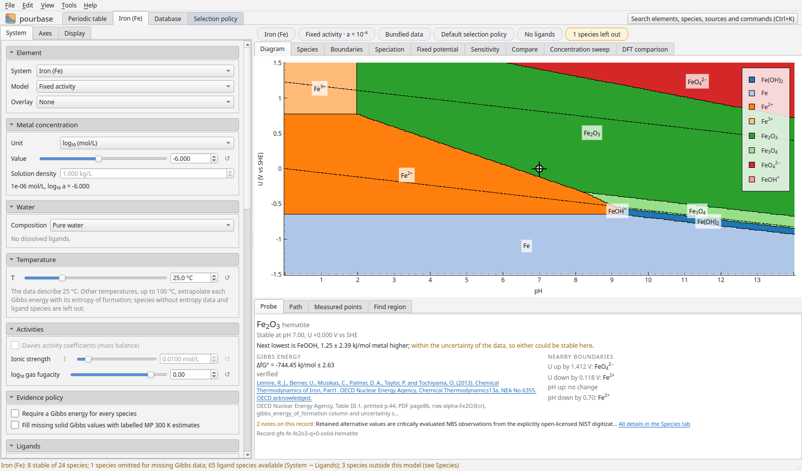

# An element

The settings are on the left in three tabs: **System** (element, model, concentration, water, temperature,
activities, evidence policy, ligands), **Axes** and **Display**. The chips above the diagram summarise them and
open the matching setting.

## Models

| Model | What it calculates |
|---|---|
| Fixed activity | Every dissolved species at the same activity, as in Pourbaix's atlas |
| Mass balance | A conserved total metal concentration shared by the dissolved species and at most one solid |

Concentrations can be given as log₁₀ molarity, molarity, ppm or weight percent. Temperatures from 0 to 100 °C
are extrapolated from the stored enthalpies and entropies.

## Views

| View | Shows |
|---|---|
| Diagram | The diagram, with a probe, paths, measured points and stability regions below |
| Species | Every species, its recommended values and all alternatives |
| Boundaries | Each boundary as a reaction and an equation, with its sources |
| Speciation | Species fractions along pH |
| Fixed potential | Solubility and ligand predominance at one potential |
| Sensitivity | How each boundary moves with the alternative published values |
| Compare | A second element, concentration or temperature on linked axes |
| Concentration sweep | Diagrams over a range of activities, as a rotatable 3D stack |
| DFT comparison | The official Materials Project diagram and an agreement map (needs the `materials-project` extra) |

## The probe

The probe reports the stable species at a point, its Gibbs energy, uncertainty and source, the next species and
the energy margin to it, and the nearest boundaries in potential and pH. Hatching on the diagram marks where
another species lies within the chosen number of combined uncertainties.
