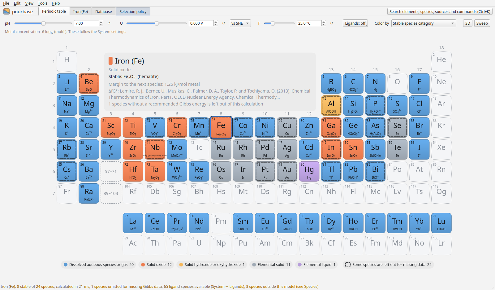

# pourbase

pourbase is a source-linked database of experimental standard thermochemistry and a Python package and desktop
app for calculating Pourbaix diagrams. Every value keeps its citation, its exact location in the source, an
evidence status, its uncertainty where reported, and every alternative value that was published for it. A
selection policy decides which value is used, and you can read, change or replace it.

- [Install](install.md): the package, the app and the optional extras.
- [Tour](tour.md): iron, from the periodic table to the sources behind one boundary.
- [The app](app/index.md): the periodic table, an element's diagrams, the database and the policy.
- [Python](python/index.md): the same calculations as a script.
- [The data](data/selection.md): how values are selected, and what could not be included.
- [Reference](reference/calculation.md): every class and function, from the docstrings.

The database ships inside the package, so calculations run offline, with no download, API key or data path.
Values were gathered with agent-guided literature searches and every one links to the table, row or page it
came from; check the ones your conclusions depend on, and
[report](https://github.com/FrederikLizakJohansen/pourbase/issues/new/choose) any that are wrong.
