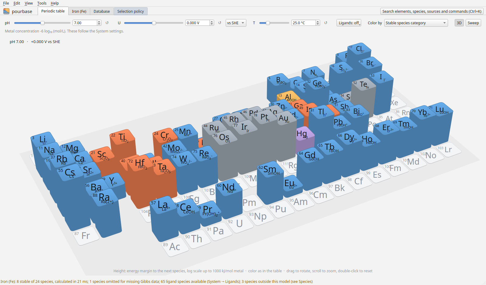
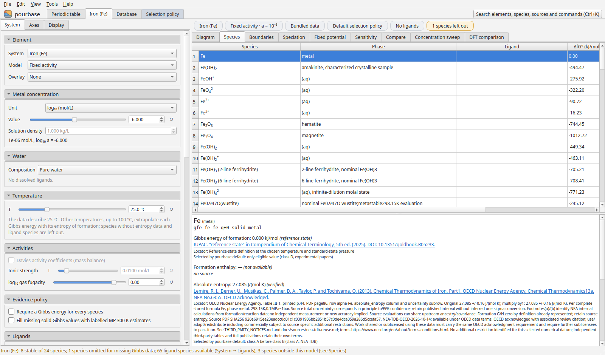
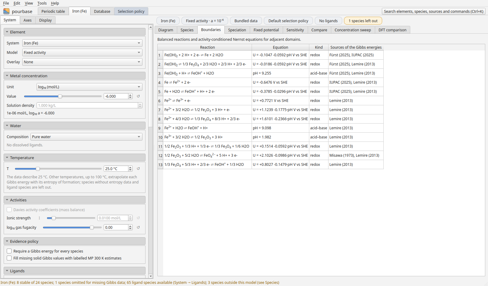
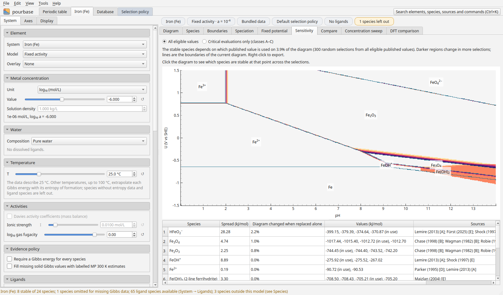

# Tour

This tour follows iron from the periodic table to the sources behind one of its boundaries. The screenshots are
made by `docs/screens.py` with the bundled database.

## 1 The periodic table

The app opens on the periodic table: the stable species of every element at the pH, potential and temperature
at the top, for a dissolved metal activity of 10⁻⁶. Hovering over an element shows its stable species, the
energy margin to the next species and the source of its Gibbs energy. Dashed outlines mark elements where some
species are left out for missing data.

**3D** raises the table into columns as tall as each element's stability margin; drag to rotate. **Sweep**
plays the table through a range of pH or potential.

## 2 The iron diagram

Clicking iron opens its system. The settings are on the left, the diagram on the right, and the probe below it
reports the stable species at the marked point: here hematite at pH 7 and 0 V, with its Gibbs energy,
uncertainty and source, the next species (FeOOH, only 1.25 kJ mol⁻¹ higher, within the uncertainty of the data)
and the nearest boundaries.

The chips above the diagram show what the calculation uses: the system, the model, the data, the selection
policy, the ligands and how many species are left out. Each chip opens the matching setting.

## 3 The values behind it

**Species** lists every species of the system with its recommended values and every alternative published
value, with the policy's reason for its choice.

**Boundaries** gives every boundary as a balanced reaction and an equation, with the sources used.

**Sensitivity** shows how far each boundary moves when one recommended value is replaced by an alternative.

## 4 The database and the policy

**Database** browses every species, value and source. **Selection policy** shows the rule that chose the
recommended values, as editable text; Apply recalculates everything with your version.

